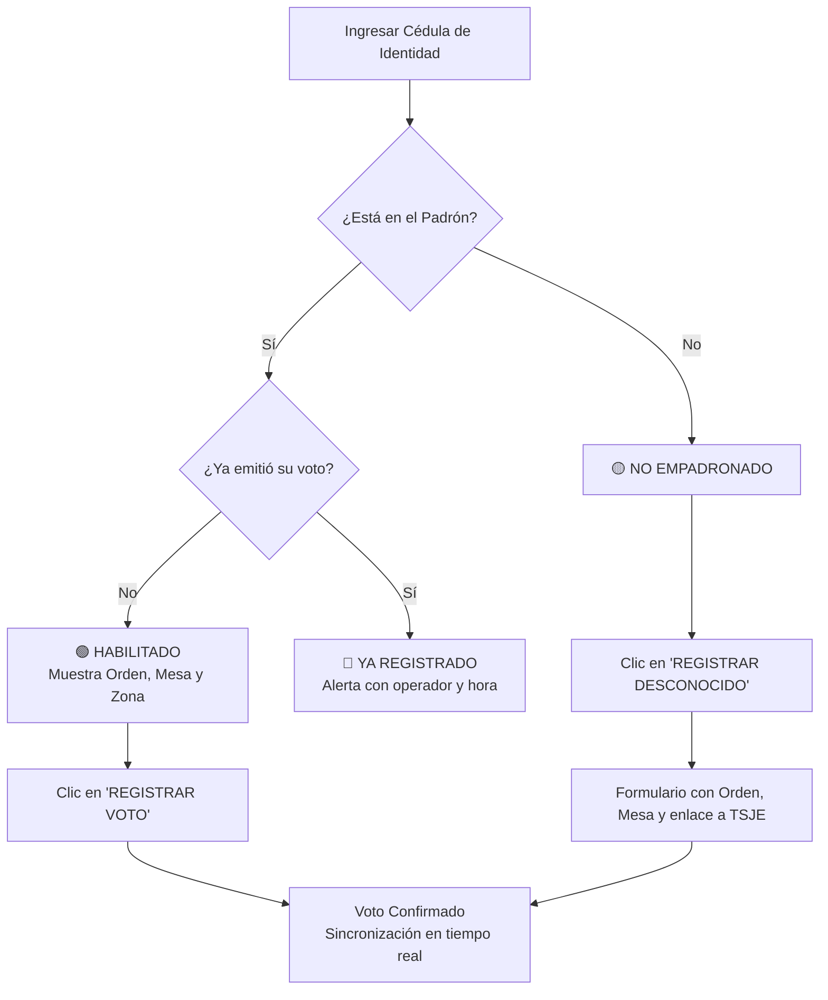

# 🗳️ Plataforma de Control de Padrón Electoral y Confirmación de Votos

[](LICENSE)
[](#)
[](#)
[](#)
[](#)
[](#)

Sistema web profesional de alto rendimiento y arquitectura de archivo único (`index.html`), diseñado para la gestión, verificación y confirmación de votos en tiempo real durante jornadas electorales. Permite la operación distribuida y simultánea de múltiples operadores y sedes, sincronizando de forma instantánea el estado de cada elector para prevenir el doble voto y auditar la participación.

---

## 📋 Tabla de Contenidos

1. [Características Principales](#-características-principales)
2. [Arquitectura y Seguridad](#-arquitectura-y-seguridad)
3. [Stack Tecnológico](#-stack-tecnológico)
4. [Estructura del Proyecto](#-estructura-del-proyecto)
5. [Inicio Rápido (Modo Local / Demo)](#-inicio-rápido-modo-local--demo)
6. [Configuración de Supabase (Producción)](#-configuración-de-supabase-producción)
7. [Guía de Uso del Sistema](#-guía-de-uso-del-sistema)
8. [Formato de Importación de Padrón (Excel)](#-formato-de-importación-de-padrón-excel)
9. [Despliegue en la Nube](#-despliegue-en-la-nube)
10. [Preguntas Frecuentes y Solución de Problemas](#-preguntas-frecuentes-y-solución-de-problemas)
11. [Licencia](#-licencia)

---

## 🚀 Características Principales

- **⚡ Búsqueda Instantánea por Cédula**: Autofoco continuo, procesamiento con tecla Enter y validación numérica en tiempo real con indicador visual.
- **🚥 Estados Visuales Claros**:
  - 🟢 **Habilitado para Votar**: Muestra datos completos, tarjetas de Mesa, Orden, Local/Zona y Referente.
  - 🔴 **Ya Registrado**: Alerta inmediata de advertencia indicando la fecha, hora exacta y el operador que registró la asistencia.
  - 🟡 **No Empadronado**: Opción rápida de "Registrar Persona Desconocida" con enlace directo al padrón oficial (TSJE).
- **🔄 Sincronización en Tiempo Real**: Notificaciones y actualizaciones automáticas vía Supabase Realtime entre todas las terminales y operadores conectados.
- **🛡️ Modo Demo Offline Completo**:
  - Funciona de forma 100% autónoma sin necesidad de backend o conexión a internet.
  - Almacenamiento local encriptado (`AES-GCM` persistente en `localStorage`).
  - Detección y fallback automático al Modo Demo si la conexión a Supabase no responde o está suspendida.
- **📊 Importación Masiva de Excel**:
  - Carga directa de planillas `.xlsx` / `.xls` en el navegador vía SheetJS.
  - Barra de progreso por lotes, deduplicación automática y operación `upsert` que preserva los votos ya registrados.
- **📋 Copiado al Portapapeles con 1 Clic**: Clic en Cédula, Orden, Mesa o Zona para copiar instantáneamente.
- **📈 Estadísticas en Vivo**: Contadores actualizados en tiempo real de Total Empadronados, Asistencias Confirmadas y Pendientes.
- **📝 Registro de Actividad y Auditoría**:
  - Panel con historial de consultas y registros detallando operador, sede y timestamp.
  - Filtro por operador y exportación a formato CSV con codificación UTF-8 BOM para compatibilidad total con Microsoft Excel.
- **🔍 Explorador de Padrón**: Modal interactivo para visualizar y buscar electores, filtrar por estado (Todos / Registrados / Pendientes) y exportar resultados.
- **💾 Copias de Seguridad (Backup & Restore)**: Exportación e importación del estado completo (padrón, configuración y logs) en formato JSON encriptado.

---

## 🔒 Arquitectura y Seguridad

El sistema sigue principios estrictos de seguridad orientada a la privacidad del elector y la integridad de la jornada:

- **Sin credenciales expuestas**: La aplicación no incluye claves privadas ni tokens de servicio hardcodeados. Las conexiones se realizan con clave anónima pública de Supabase controlada por políticas RLS.
- **Content Security Policy (CSP)**: Cabecera CSP restrictiva que mitiga ataques de inyección de scripts (XSS) y restringe orígenes de conexión autorizados.
- **Encriptación Local AES-GCM**: La información sensible almacenada en el navegador para el Modo Demo o caché local se encripta mediante la API Web Crypto nativa, con clave persistente en `localStorage`.
- **Sanitización y Validación Rigurosa**: Validación estricta de entradas (cédulas numéricas, nombres válidos, zonas con soporte para caracteres como `N°`, `#`, `º`).
- **Control de Frecuencia (Rate Limiting)**: Limitación en cliente para evitar consultas automatizadas masivas o sobrecargas accidentales (búsquedas: 60/min, votos: 20/min, importaciones: 5/5min).
- **Feedback Auditivo**: Señales de audio discretas (Web Audio API) que confirman éxito o alertan sobre anomalías sin requerir dependencias de audio externas.

---

## 🛠️ Stack Tecnológico

| Componente | Tecnología / Librería | Descripción |
|---|---|---|
| **Frontend** | HTML5, JavaScript Vanilla (ES6+) | Código optimizado sin frameworks pesados ni compiladores |
| **Estilos** | Tailwind CSS (CDN oficial) | Diseño responsivo para pantallas táctiles, portátiles y monitores |
| **Backend & Base de Datos** | Supabase (PostgreSQL 15+) | Autenticación de operadores, base de datos relacional y Realtime WebSockets |
| **Cliente Supabase** | `supabase.min.js` (Local) | Distribución local incluida para evitar bloqueos por extensiones de privacidad |
| **Motor Excel** | SheetJS (xlsx CDN) | Procesamiento y lectura de libros de cálculo en el cliente |
| **Criptografía** | Web Crypto API (`AES-GCM`) | Encriptación simétrica nativa del navegador |

---

## 📂 Estructura del Proyecto

```text
├── index.html              # Aplicación web completa (Single-Page Application)
├── supabase.min.js         # Cliente Supabase JS para uso offline / CDN fallback
├── package.json            # Metadatos del proyecto y dependencias de utilidad
├── .gitignore              # Reglas de exclusión para datos y archivos confidenciales
└── README.md               # Documentación general del sistema
```

> ⚠️ **Privacidad de Datos**: Por estrictas normas de confidencialidad y protección de datos personales, los archivos de padrón electoral (`.xlsx`, `.xls`, `.csv`), volcados de bases de datos y scripts de conversión locales están estrictamente excluidos del control de versiones mediante `.gitignore`.

---

## ⚡ Inicio Rápido (Modo Local / Demo)

### 1. Clonar el repositorio

```bash
git clone https://github.com/starnicosvv/PlataformaVoto.git
cd PlataformaVoto
```

### 2. Iniciar un servidor HTTP local

> ⚠️ **Importante**: No abras el archivo `index.html` haciendo doble clic (`file:///`). Los navegadores restringen `localStorage`, Web Crypto y peticiones a CDN bajo el protocolo local de archivos.

Elige cualquiera de las siguientes opciones:

#### Opción A: Python 3 (Recomendado)
```bash
python -m http.server 8080
```

#### Opción B: Node.js (npx)
```bash
npx serve .
```

#### Opción C: PHP
```bash
php -S localhost:8080
```

#### Opción D: Visual Studio Code
Instala la extensión **Live Server**, haz clic derecho en `index.html` y selecciona **"Open with Live Server"**.

### 3. Acceder al sistema
Abre tu navegador en:
```
http://localhost:8080
```

El sistema iniciará en **Modo Demo**, precargado con registros de prueba para que puedas explorar todas las funciones de búsqueda, registro, carga de Excel y auditoría sin necesidad de configurar una base de datos.

---

## ☁️ Configuración de Supabase (Producción)

Para utilizar el sistema en una jornada electoral real con sincronización distribuida:

### 1. Crear el proyecto en Supabase
1. Accede a [supabase.com](https://supabase.com) y crea un nuevo proyecto.
2. En la sección **Project Settings → API**, localiza la **URL del Proyecto** y la clave **anon public key**.

### 2. Estructura de la Base de Datos
Ejecuta el siguiente script en el **SQL Editor** de tu proyecto Supabase:

```sql
-- 1. Tabla principal del padrón de votantes
create table padron (
  cedula text primary key,
  nombre text not null,
  orden integer,
  mesa integer,
  referente text,
  zona_votacion text,
  ya_registrado boolean default false,
  fecha_registro timestamptz,
  registrado_por text
);

-- 2. Tabla de sedes o recintos electorales
create table sedes (
  id uuid primary key default gen_random_uuid(),
  nombre text not null unique,
  created_at timestamptz default now()
);

-- 3. Perfiles de usuario (vinculado a Supabase Auth)
create table profiles (
  id uuid primary key references auth.users(id) on delete cascade,
  email text not null,
  nombre text not null,
  sede_id uuid references sedes(id),
  role text default 'operador' check (role in ('admin', 'operador')),
  created_at timestamptz default now()
);

-- 4. Registro histórico de actividad
create table activity_log (
  id bigserial primary key,
  cedula text not null,
  nombre text not null,
  accion text not null,
  usuario text,
  sede text,
  timestamp timestamptz not null
);

-- 5. Habilitar sincronización Realtime
alter publication supabase_realtime add table padron;
alter publication supabase_realtime add table sedes;
alter publication supabase_realtime add table profiles;
alter publication supabase_realtime add table activity_log;

-- 6. Configuración de Seguridad por Filas (Row Level Security)
alter table sedes enable row level security;
create policy "Lectura de sedes para todos" on sedes for select using (true);
create policy "Inserción de sedes solo admins" on sedes for insert with check (
  exists (select 1 from profiles where id = auth.uid() and role = 'admin')
);

alter table profiles enable row level security;
create policy "Usuarios leen su perfil" on profiles for select using (auth.uid() = id);
create policy "Admins ven todos los perfiles" on profiles for select using (
  exists (select 1 from profiles where id = auth.uid() and role = 'admin')
);
create policy "Creación de perfil propio" on profiles for insert with check (auth.uid() = id);

-- 7. Trigger para creación automática de perfil al registrarse
create or replace function public.handle_new_user()
returns trigger language plpgsql security definer set search_path = '' as $$
begin
  insert into public.profiles (id, email, nombre, role)
  values (new.id, new.email, coalesce(new.raw_user_meta_data->>'nombre', 'Operador'), 'operador');
  return new;
end;
$$;

create trigger on_auth_user_created
  after insert on auth.users
  for each row execute procedure public.handle_new_user();

-- 8. Sedes iniciales de ejemplo
insert into sedes (nombre) values 
  ('Sede Central - Colegio Nacional'),
  ('Sede Norte - Escuela Básica N° 45'),
  ('Sede Sur - Polideportivo Municipal')
on conflict (nombre) do nothing;
```

### 3. Conectar la aplicación web
1. En la aplicación, haz clic en el botón **"Config"** (icono de engranaje).
2. Ingresa la **URL de Supabase** y la **Anon Key**.
3. Presiona **"Guardar y Conectar"**.
4. Haz clic en **"Registrarse"** en el modal de inicio de sesión para crear la primera cuenta de operador.
5. *(Opcional)* Para convertir un usuario en administrador, ejecuta en el SQL Editor:
   ```sql
   update profiles set role = 'admin' where email = 'tu_correo@ejemplo.com';
   ```

---

## 📖 Guía de Uso del Sistema

### Flujo de Verificación y Votación



1. **Consulta**: El operador escribe el número de documento y presiona Enter.
2. **Confirmación**: Se verifican los datos en pantalla y se presiona **"REGISTRAR"**.
3. **Sincronización**: En menos de un segundo, la persona queda registrada en todas las demás mesas del recinto, previniendo suplantaciones o dobles votos.

---

## 📑 Formato de Importación de Padrón (Excel)

La plataforma admite libros de cálculo `.xlsx` o `.xls`. El archivo debe contener obligatoriamente las columnas `cedula` y `nombre`.

### Columnas soportadas

| Columna | Obligatoria | Tipo | Descripción / Ejemplo |
|---|---|---|---|
| `cedula` | **Sí** | Texto / Número | Cédula del elector (ej. `1234567`) |
| `nombre` | **Sí** | Texto | Nombre y apellido completo (ej. `Juan Pérez`) |
| `orden` | No | Número entero | Número de orden en el padrón de mesa (ej. `45`) |
| `mesa` | No | Número entero | Número de mesa asignada (ej. `3`) |
| `referente` | No | Texto | Referente o contacto de coordinación |
| `zona_votacion` | No | Texto | Colegio, local de votación o seccional |

### Ejemplo de estructura

| cedula | nombre | orden | mesa | referente | zona_votacion |
|---|---|---|---|---|---|
| 1234567 | Juan Pérez García | 14 | 2 | Carlos Ramírez | Escuela Graduada N° 12 |
| 2345678 | María González Ortiz | 102 | 5 | Ana Martínez | Colegio Nacional Defensores |
| 3456789 | Luis Alberto Sánchez | 77 | 3 | Pedro Benítez | Polideportivo San Juan |

> 💡 **Nota**: Durante la importación, la plataforma realiza un proceso `upsert`: si una cédula ya existía y tenía un voto registrado previamente, se preserva dicho voto y su fecha/hora original sin alterar la auditoría.

---

## 🌐 Despliegue en la Nube

Al tratarse de una aplicación estática cliente, puede ser alojada gratuitamente en cualquier plataforma moderna de hosting:

### Vercel
1. Ingresa a [vercel.com](https://vercel.com) y conecta tu repositorio de GitHub.
2. Selecciona Framework Preset: **Other**.
3. Deja los campos Build Command y Output Directory vacíos.
4. Haz clic en **Deploy**.

### Netlify
1. Conecta el repositorio en [netlify.com](https://netlify.com).
2. Deja el comando de compilación en blanco y el directorio de publicación en `.`.
3. Haz clic en **Deploy Site**.

### Cloudflare Pages
1. Ve a **Workers & Pages** en tu panel de Cloudflare.
2. Conecta el repositorio Git, define la rama `master` y directorio raíz `/`.
3. Despliega en segundos con protección DDoS y CDN global.

---

## ❓ Preguntas Frecuentes y Solución de Problemas

| Situación | Causa Común | Solución |
|---|---|---|
| **Pantalla en blanco o botones sin respuesta** | Apertura con `file://` en lugar de servidor web | Ejecuta un servidor local (`python -m http.server 8080`) |
| **"Supabase no responde. Se activa el Modo Demo"** | URL o Anon Key erróneas, o proyecto de Supabase pausado | Revisa las credenciales en el modal de Configuración o reactiva el proyecto en el dashboard de Supabase |
| **No se sincronizan los votos entre dispositivos** | La tabla `padron` no está incluida en la publicación de Realtime | Ejecuta en Supabase: `alter publication supabase_realtime add table padron;` |
| **El archivo Excel no se procesa** | Nombres de columnas incorrectos | Asegúrate de que las cabeceras contengan `cedula` y `nombre` en minúsculas |
| **Pérdida de sesión al recargar la pestaña** | Modo incógnito o almacenamiento bloqueado en el navegador | Permite el uso de `localStorage` para el origen en la configuración del navegador |

---

## 📄 Licencia

Este proyecto se distribuye bajo la licencia **MIT**. Eres libre de usarlo, modificarlo y desplegarlo para propósitos electorales, auditorías cívicas, gremiales o educativas. Consulta el archivo [LICENSE](LICENSE) para más detalles.

---

<p align="center">
  Diseñado con enfoque en transparencia, velocidad y resiliencia electoral 🗳️
</p>
